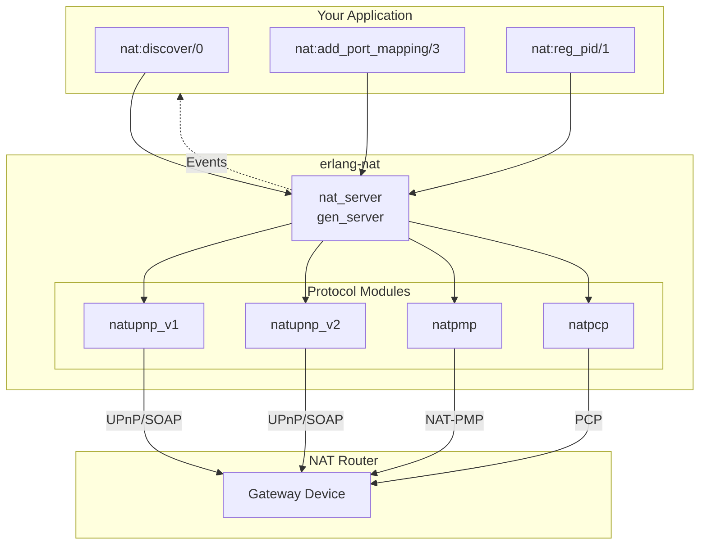

# API Reference

This section documents the public API modules of erlang-nat.

## Architecture



## Modules

| Module | Description |
|--------|-------------|
| [nat](nat.md) | Main public API for NAT traversal operations |
| [nat_server](nat_server.md) | Gen_server managing port mappings with auto-renewal |

## Quick Reference

### Discovery

```erlang
nat:discover() -> ok | no_nat | {error, term()}.
nat:get_context() -> {ok, nat_ctx()} | {error, no_context}.
```

### Port Mapping

```erlang
nat:add_port_mapping(Protocol, InternalPort, ExternalPort) -> Result.
nat:add_port_mapping(Protocol, InternalPort, ExternalPort, Lifetime) -> Result.
nat:delete_port_mapping(Protocol, InternalPort, ExternalPort) -> ok | {error, term()}.
nat:list_mappings() -> [{Protocol, InternalPort, ExternalPort, ExpiresAt}].
```

### Addresses

```erlang
nat:get_external_address() -> {ok, string()} | {error, term()}.
nat:get_device_address() -> {ok, string()} | {error, term()}.
nat:get_internal_address() -> {ok, string()} | {error, term()}.
```

### Events

```erlang
nat:reg_pid(pid()) -> ok.
nat:unreg_pid(pid()) -> ok.
nat:reg_fun(fun()) -> {ok, reference()}.
nat:unreg_fun(reference()) -> ok.
```
