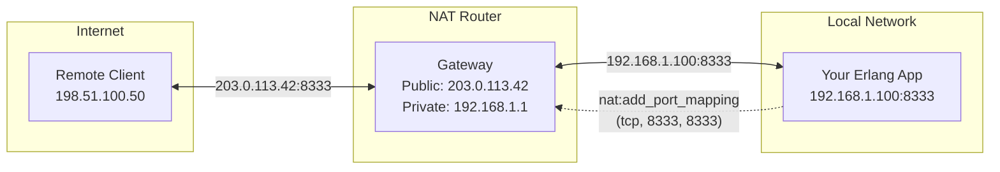

# erlang-nat

**NAT traversal library for Erlang/OTP**

erlang-nat provides a unified interface for NAT (Network Address Translation) traversal, supporting multiple protocols to ensure maximum compatibility with different router implementations.

## Features

- **Multiple Protocol Support**: UPnP IGD (v1 & v2), NAT-PMP, and PCP
- **Automatic Protocol Selection**: Discovers and uses the best available protocol
- **Port Mapping Lifecycle Management**: Automatic renewal before expiry
- **Event System**: Notifications for mapping changes and IP address changes
- **IPv4 and IPv6 Support**: Full IPv6 support via PCP protocol
- **OTP Application**: Runs as a supervised OTP application

## How It Works



<div style="text-align: center; margin: 1em 0; color: #666;">
<em>erlang-nat automatically creates port mappings so remote clients can reach your application</em>
</div>

## Supported Protocols

| Protocol | RFC | Port | Description |
|----------|-----|------|-------------|
| UPnP IGD v1 | - | 1900/UDP | Universal Plug and Play Internet Gateway Device |
| UPnP IGD v2 | - | 1900/UDP | UPnP IGD with improved port allocation |
| NAT-PMP | RFC 6886 | 5351/UDP | NAT Port Mapping Protocol |
| PCP | RFC 6887 | 5351/UDP | Port Control Protocol (IPv6-capable successor to NAT-PMP) |

## Quick Example

```erlang
%% Start the application
application:ensure_all_started(nat).

%% Discover NAT gateway (stores context internally)
ok = nat:discover().

%% Get external IP address
{ok, "203.0.113.42"} = nat:get_external_address().

%% Add a port mapping (auto-renewed)
{ok, _Since, 8333, 8333, 3600} = nat:add_port_mapping(tcp, 8333, 8333).

%% Register for events
nat:reg_pid(self()).

%% Receive events
receive
    {nat_event, {mapping_renewed, tcp, 8333, 8333, NewLifetime}} ->
        io:format("Mapping renewed for ~p seconds~n", [NewLifetime]);
    {nat_event, {ip_changed, OldIp, NewIp}} ->
        io:format("IP changed: ~s -> ~s~n", [OldIp, NewIp])
end.

%% Delete the mapping when done
ok = nat:delete_port_mapping(tcp, 8333, 8333).
```

## Use Cases

- **P2P Applications**: Enable incoming connections for peer-to-peer protocols
- **Game Servers**: Host game servers behind NAT
- **VoIP/SIP**: Enable direct media paths for voice/video calls
- **IoT Devices**: Allow external access to home automation devices
- **Distributed Systems**: Enable direct node-to-node communication

## Requirements

- Erlang/OTP 26 or later
- rebar3

## License

MIT License

## Links

- [GitHub Repository](https://github.com/benoitc/erlang-nat)
- [Hex Package](https://hex.pm/packages/nat)
